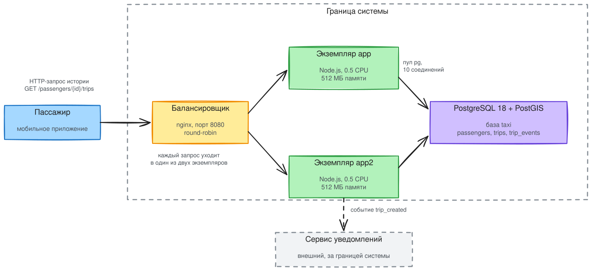
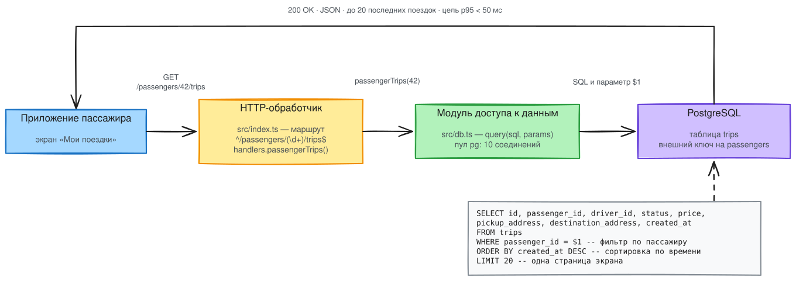

# Сервис такси под нагрузкой

## Граница системы

Бэкенд городского такси. Принимает заказ, назначает водителя, ведет поездку до
завершения и отдает пассажиру его историю.

Для проектирования важно одно свойство. Это единственное место, где состояние
поездки меняется. Приложения, карты, платежи вокруг читают его или присылают
события, но правду о поездке держит сервис, и спорить с ним некому.

### Кто с ним работает

| Пользователь | Что делает | Через что |
| --- | --- | --- |
| Пассажир | Создает поездку, следит за ее состоянием, открывает историю | Мобильное приложение пассажира |
| Водитель | Принимает поездку, шлет координаты | Мобильное приложение водителя |
| Оператор поддержки | Ищет поездку по адресу, отменяет ее | Внутренняя панель |

### Внешние участники

| Участник | Направление | Роль |
| --- | --- | --- |
| Мобильные приложения пассажира и водителя | входящее | Единственные источники запросов на запись |
| Балансировщик nginx | входящее | Раскидывает запросы между двумя экземплярами |
| PostgreSQL с PostGIS | исходящее | Хранит поездки, водителей, координаты, тарифы |
| Сервис уведомлений | исходящее | Получает событие о созданной поездке. Внешний и ненадежный, ответа не ждем |

k6 в этой таблице нет намеренно. Он создает нагрузку на стенде и частью
продукта не является.

### Что внутри границы

HTTP-API сервиса и его база. Создание поездки с ключом идемпотентности,
назначение и отмена, чтение состояния, прием координат водителя и поиск
ближайших, история поездок пассажира, справочник тарифов, `/health` и
`/metrics`.

### Что снаружи

Мобильные приложения и их экраны, маршруты и карты, платежи, доставка пушей
(сервис только отдает событие наружу), антифрод, аналитика, авторизация.

Это не отменяет их сложности. Просто на числа ниже они не влияют и в расчет
частот не попадают.

## Требования

Три потока задают нагрузку. Исходные числа и коэффициенты пика взяты из
условия задачи, дальше арифметика.

| Поток | Исходное число | Коэффициент пика |
| --- | --- | --- |
| Создание поездки | 200 000 поездок в сутки | ×4 |
| Чтение состояния | 1 запрос каждые 5 секунд в течение поездки длиной 15 минут | ×4 |
| Просмотр истории | 60 000 открытий в сутки | ×2 |

Средняя частота считается как суточное число, деленное на 86 400 (столько
секунд в сутках: 24 × 60 × 60). Пиковая получается умножением средней на
коэффициент.

### Расчет

**Создание поездки.** 200 000 поездок/сутки ÷ 86 400 с = **2,31 запроса/с**.
Пик: 2,31 × 4 = **9,26 запроса/с**.

**Просмотр истории.** 60 000 открытий/сутки ÷ 86 400 с = **0,69 запроса/с**.
Пик: 0,69 × 2 = **1,39 запроса/с**.

**Чтение состояния** считается в четыре действия, потому что исходное число
задано не на сутки, а на одну поездку.

| Действие | Исходное число | Что делаем | Результат |
| --- | --- | --- | --- |
| Длительность поездки в секундах | 15 мин | × 60 с | 900 с |
| Чтений за одну поездку | 900 с, опрос раз в 5 с | ÷ 5 | 180 запросов/поездку |
| Чтений в сутки | 200 000 поездок/сутки, по 180 на каждую | × 180 | 36 000 000 запросов/сутки |
| Средняя частота | 36 000 000 запросов/сутки | ÷ 86 400 с | 416,7 запроса/с |
| Пиковая частота | 416,7 запроса/с | × 4 | 1 666,7 запроса/с |

| Поток | Средняя | Пиковая |
| --- | --- | --- |
| Создание поездки | 2,31 запроса/с | 9,26 запроса/с |
| Чтение состояния | 416,7 запроса/с | 1 666,7 запроса/с |
| Просмотр истории | 0,69 запроса/с | 1,39 запроса/с |
| Всего | 419,7 запроса/с | 1 677,4 запроса/с |

Из этих трех строк следует главное для архитектуры. Чтение состояния дает 99 %
всех запросов, запись меньше процента. Систему нагружает не заказ машины, а
бесконечное «где она едет».

### Объем за год

200 000 поездок/сутки × 365 суток = **73 000 000 поездок/год**.

Сходится и со средней частотой: 2,31 поездки/с × 31 536 000 с/год = 73 млн.

Отсюда берется объем для опытов. 2 000 000 поездок это примерно десять суток
работы города. Не круглое число из воздуха, а состояние, до которого сервис
доживет на второй неделе.

### Цели

p95 истории меньше 50 мс на двух миллионах поездок. Доля ошибок не выше 0,1 %.
Обе снимаются из отчета k6: `http_req_duration{scenario:history}` и
`http_req_failed`.

### Частоты стенда

| Поток | На стенде | В городе, пик |
| --- | --- | --- |
| Создание поездки | 5 запросов/с | 9,26 запроса/с |
| Чтение состояния | 20 запросов/с | 1 666,7 запроса/с |
| Просмотр истории | 5 запросов/с | 1,39 запроса/с |

Стенд не воспроизводит город и не пытается. Полторы тысячи запросов в секунду
на одной машине недостижимы: два экземпляра приложения по половине ядра, одна
база и сам генератор делят процессор ноутбука, и упрется не проверяемое
решение, а железо под ним. Поэтому чтение состояния занижено на два порядка.

История, наоборот, завышена: 5 запросов/с против городских 1,39. Это сделано
нарочно. Медленный запрос должен успеть проявиться за тридцать секунд прогона,
иначе замер покажет шум вместо эффекта.

Локальный опыт проверяет не производительность города, а причинную связь. Одно
изменение, один замер, одно отличие в числах. Нагрузка держится постоянной,
данные те же, меняется один фактор. Тогда разница в p95 между прогонами
объясняется этим фактором, а не совпадением.

Переносится отсюда направление и порядок эффекта. Абсолютные миллисекунды нет.

## Операции

| Операция | Сценарий | Запрос | Средняя | Пиковая |
| --- | --- | --- | --- | --- |
| Создание поездки | Пассажир заказывает машину. Запись идет в основную базу одной транзакцией вместе с ключом идемпотентности | `POST /trips` | 2,31 запроса/с | 9,26 запроса/с |
| Чтение состояния | Приложение опрашивает поездку раз в 5 секунд все 15 минут | `GET /trips/{id}` | 416,7 запроса/с | 1 666,7 запроса/с |
| Просмотр истории | Пассажир открывает «Мои поездки» и видит последние 20 записей | `GET /passengers/{id}/trips` | 0,69 запроса/с | 1,39 запроса/с |

## Окружение



Запрос пассажира не попадает в приложение напрямую. Он приходит на `nginx`, и
тот по round-robin отдает его одному из двух экземпляров. Какому именно, запрос
не выбирает и знать не может: экземпляры одинаковы, состояния в памяти не
держат, ходят в одну и ту же базу. Кто ответил, видно в заголовке `x-instance`.

Для замеров отсюда следуют две вещи. Два экземпляра удваивают процессорную
емкость приложения, но не базы, она одна. И разброс в замере нельзя списать на
«повезло с экземпляром»: ответ от выбора экземпляра не зависит, значит разброс
объясняется очередью и диском.

Сервис уведомлений остается за границей. Приложение отдает ему событие
`trip_created` и не ждет подтверждения, поэтому его задержка в путь истории не
входит.

Исходник схемы лежит там же, где картинка. Сцена вложена в файл, так что
`environment.excalidraw.svg` открывается в Excalidraw и правится.

## Компоненты



### Критический путь истории

1. **HTTP-запрос.** Приложение открывает «Мои поездки» и шлет
   `GET /passengers/42/trips` на балансировщик.
2. **Маршрутизация, `src/index.ts`.** Экземпляр проверяет, не выведен ли он из
   работы и не исчерпан ли предел одновременных запросов. Обе проверки идут до
   обращения к базе. Дальше путь сопоставляется с `^/passengers/(\d+)/trips$`,
   из него достается идентификатор, счетчик `inflight` растет на единицу.
3. **Обработчик, `src/handlers.ts`.** `passengerTrips(42)` выбирает источник
   чтения (копию, если включен `READ_HISTORY_FROM_REPLICA`, иначе основную
   базу) и собирает SQL с параметром `$1`.
4. **Доступ к данным, `src/db.ts`.** `query()` берет соединение из пула pg, по
   десять на экземпляр. Свободного нет, запрос ждет `POOL_TIMEOUT_MS`, после
   чего получает 503 вместо бесконечного ожидания. Ожидание в пуле и время
   самой команды меряются раздельно: они упираются в разные пределы, и по одной
   цифре их не различить.
5. **PostgreSQL.** Один запрос к `trips`: фильтр по `passenger_id`, порядок по
   `created_at DESC`, `LIMIT 20`.
6. **Ответ.** Строки превращаются в JSON, добавляется `x-source`, уходит
   `200 OK`, задержка пишется в метрики, `inflight` уменьшается.

Узкое место здесь одно, пятый шаг. Остальные стоят единицы миллисекунд и от
объема данных не зависят. Пятый зависит: отбор и сортировка идут по таблице,
которая растет на 73 млн строк в год. Его и измеряет цель p95 < 50 мс, он же
исправлен в [ADR 010](design/adr/010-history-index.md).

## Модель данных

```
passengers                          trips
----------                          -----
id        BIGINT PK  <──────┐       id                   BIGINT PK
name      VARCHAR(100)      └────── passenger_id         BIGINT NOT NULL FK
phone     VARCHAR(32) UNIQUE        driver_id            BIGINT NULL FK → drivers
                                    status               VARCHAR(32)
                                    price                NUMERIC(12,2)
                                    pickup_address       VARCHAR(500)
                                    destination_address  VARCHAR(500)
                                    cancel_reason        VARCHAR(64)
                                    created_at           TIMESTAMPTZ NOT NULL
```

Один ко многим: у пассажира много поездок, у поездки ровно один пассажир. На
стороне `trips` это внешний ключ `passenger_id → passengers (id)` с `NOT NULL`,
поездки без пассажира не бывает. Обратное неверно. У только что
зарегистрированного человека поездок нет, и это нормальное состояние, а не
ошибка загрузки.

Поездка ссылается еще и на водителя (`driver_id` допускает `NULL`: в статусе
`searching` водителя пока нет) и порождает записи в `trip_events`. К истории это
отношения не имеет, запрос истории читает только `trips`.

### Что отбирает и что сортирует

| Поле | Тип | Роль |
| --- | --- | --- |
| `passenger_id` | `BIGINT NOT NULL`, FK → `passengers (id)` | отбор: `WHERE passenger_id = $1` |
| `created_at` | `TIMESTAMPTZ NOT NULL DEFAULT NOW()` | порядок: `ORDER BY created_at DESC` |
| `id` | `BIGINT` PK | идентификатор записи в ответе |
| `driver_id`, `status`, `price`, `pickup_address`, `destination_address` | | только выводятся |

```sql
SELECT id, passenger_id, driver_id, status, price,
       pickup_address, destination_address, created_at
FROM trips
WHERE passenger_id = $1
ORDER BY created_at DESC
LIMIT 20;
```

Фильтр по пассажиру задает границу видимости. Экран показывает поездки одного
человека, чужие ему не принадлежат. Он же определяет, какая доля таблицы нужна
для ответа. На стенде 2 млн поездок разложены по 10 тыс. пассажиров, в среднем
по 200 на человека, то есть ответу нужны 0,01 % строк. Остальное работа,
которую хочется не делать.

Сортировка по времени нужна потому, что ценность поездки падает со временем.
Историю открывают ради последней: повторить маршрут, найти сумму,
пожаловаться. Поездка годичной давности на первом экране не нужна никому,
поэтому записи идут от свежих к старым, а `LIMIT 20` отдает одну страницу.

Вместе эти три условия описывают форму доступа: не «вся таблица», а «свежий
хвост по одному пассажиру». Если база читает все 2 млн строк, отбирает свои 200
и сортирует их, она делает работу, которой форма запроса не требует.

Это и есть разрыв, который измеряется целью p95 < 50 мс. Закрыт он индексом
`trips (passenger_id, created_at DESC)`: [ADR 010](design/adr/010-history-index.md),
замеры до и после в [reports/baseline.md](reports/baseline.md) и
[reports/after-index.md](reports/after-index.md).

## Итог

### Что получилось

| Требование | Было | Решение | Стало |
| --- | --- | --- | --- |
| p95 истории < 50 мс на 2 млн поездок | 4 590 мс | Индекс `trips (passenger_id, created_at DESC)`: [ADR 010](design/adr/010-history-index.md), миграция `db/migrations/007-history-index.sql` | **47,67 мс** |
| Доля ошибок ≤ 0,1 % | 0,00 % | то же | 0,00 % |
| Генератор подает заявленную частоту | `dropped_iterations` = 0 | то же | `dropped_iterations` = 0 |
| Чтение таблицы | Parallel Seq Scan, 2 000 000 строк | то же | Index Scan, 20 строк |
| Время запроса в базе под нагрузкой | 2 202,9 мс | то же | 1,68 мс |

Отчеты с условиями опыта и планами запроса:
[baseline](reports/baseline.md) и [after-index](reports/after-index.md).

Доказательством я считаю не последний столбец, а предпоследнюю строку.
Миллисекунды на локальной машине доказывают мало, они зависят от соседних
процессов, от кэша, от настроения Docker. А смена типа чтения это факт о
системе, а не о ноутбуке. Было последовательное чтение всей таблицы, стало
чтение по индексу. Было 2 млн прочитанных строк на двадцать возвращаемых,
стало двадцать. Вот это переносится куда угодно.

Сверка со стороны базы подтверждает: за прогон индекс получил 151 обращение и
отдал 3 020 строк, ровно по двадцать на запрос, ни одной лишней.

### Где этот вывод кончается

Опыт поставлен на конкретном объеме, профиле и железе. Дальше них он не
действует, и границы стоит назвать явно.

**Данные.** 2 000 000 поездок, 10 000 пассажиров, в среднем 200 поездок на
человека, таблица 466 МБ до индекса и 531 МБ после. Запрос отдает двадцать
последних записей одного пассажира. Весь выигрыш держится на избирательности:
индекс отбрасывает 99,99 % таблицы. На выборке, где у пассажира тысячи поездок
или где условие возвращает заметную долю таблицы, планировщик вернется к
последовательному чтению, и вывод перестанет действовать.

**Профиль.** 5 созданий поездки в секунду, 20 чтений состояния, 5 чтений
истории. Прогрев 10 секунд, замер 30, постоянная частота. История запрашивается
у тысячи пассажиров из десяти тысяч. Доля записи мала, поэтому цена индекса при
вставке в замере не видна вовсе. На профиле, где преобладает запись, баланс
будет другим.

**Железо.** Docker на восьми ядрах и 8,2 ГБ. Два экземпляра по 0,5 CPU и
512 МБ, одна база с `shared_buffers` в 128 МБ, nginx и k6 на той же машине.
Городской пик чтения состояния 1 666,7 запроса/с против двадцати на стенде. Два
порядка разницы, и переносить миллисекунды отсюда туда нельзя.

**Кэш и мертвые строки.** Это условие оказалось решающим, чего я в начале не
ожидал, поэтому выношу отдельно. Один и тот же план на одних и тех же двадцати
шести страницах:

| Где лежат страницы | Время |
| --- | --- |
| В кэше (`Buffers: shared hit=23`) | 3,9 мс |
| На диске (`hit=4 read=22`) | 201,4 мс |

Разница в полсотни раз при одинаковом плане. Страниц мало, но каждая, если ее
нет в памяти, стоит здесь около девяти миллисекунд. Отдельно померил мертвые
строки: 218 тысяч мертвых версий в `trips`, сотая доля таблицы, подняли p95
истории с 47,67 мс до 1,06–1,51 с.

Значит, за цифру 47,67 мс отвечает не только индекс. Отвечает еще и то, что
рабочие страницы лежат в памяти, а autovacuum успевает за записью. Профиль
обращается к тысяче пассажиров. При равномерном обращении ко всем десяти
тысячам рабочий набор вырастет вдесятеро и в `shared_buffers` уже не влезет.
Этого я не проверял, но проверить стоит раньше, чем оно выстрелит в бою.

### Что сломается следующим

После индекса время ушло из базы. Куда, видно по метрикам экземпляров:

| | baseline | after-index |
| --- | --- | --- |
| `sql` p95 | 2 017 / 2 358 мс | 20 / 20 мс |
| `pool_wait` p95 | 2 / 966 мс | 1 / 1 мс |
| Полный ответ p95 | 641 / 23 586 мс | 42 / 33 мс |

При двадцати миллисекундах в базе и одной в пуле полный ответ занимает сорок
две. Заметная часть хвоста уже не в базе, а в приложении, у которого половина
ядра на экземпляр.

Но следующий предел я вижу не в производительности, а в устойчивости.

Очередь к базе ничем не ограничена: десять соединений на экземпляр,
`POOL_TIMEOUT_MS=0` значит ждать бесконечно, `MAX_INFLIGHT=0` значит не
отсекать. Пока запросы быстрые, этого не видно. Стоит любой операции
замедлиться, очередь растет без границы. В повторных прогонах базового
состояния `pool_wait` p95 доходил до 23 439 мс, а счетчик отказов по перегрузке
оставался нулевым. Сервис не отказывал, он копил работу.

Дальше это переходит в полный отказ стенда. На этом я наступил трижды, и каждый
раз выглядело как «нагрузка положила сервис». На деле цепочка такая:

1. Нагрузка замедляет базу.
2. Проверка `pg_isready` из healthcheck в `docker-compose.yml` завершается
   ненулевым кодом.
3. PostgreSQL работает в контейнере как PID 1 и считает ненулевой код
   неотслеживаемого потомка падением бэкенда: `untracked child process ...
   exited with exit code 2`, следом `terminating any other active server
   processes`, аварийный перезапуск.
4. Соединения в пуле рвутся. Обработчика события `error` на пуле в `src/db.ts`
   нет, и Node падает с `Unhandled 'error' event`.
5. У `app` и `app2` нет `restart:` в compose, в отличие от nginx. Экземпляры
   остаются выключенными, и балансировщик отдает 504, пока их не поднимут
   руками.

Пункты 2 и 3 это свойство стенда, в бою их не будет. А 4 и 5 свойство сервиса,
и они останутся. Система сейчас не переживает собственного замедления, и чинить
это надо раньше, чем выжимать следующие проценты производительности.

### Следующий опыт

**Вопрос.** Превращает ли предел ожидания в пуле неограниченную очередь в явный
отказ, так чтобы быстрые операции продолжали отвечать, а экземпляры оставались
живыми?

**Что меняем.** Ровно одно: `POOL_TIMEOUT_MS` в `service.env` с `0` на `250`.
Профиль, набор данных, `POOL_SIZE`, `MAX_INFLIGHT`, лимиты контейнеров,
настройки базы и nginx остаются прежними.

**Как ставим.** Два прогона одного профиля на одном наборе в состоянии без
индекса (`DROP INDEX idx_trips_passenger_created_at`), так воспроизводится уже
измеренная перегрузка из [baseline](reports/baseline.md). Контрольный с
`POOL_TIMEOUT_MS=0`, опытный с `250`. Имена замеров `pool-timeout-0` и
`pool-timeout-250`.

**Прошло, если** в опытном прогоне сошлось все сразу:

- p95 чтения состояния `GET /trips/{id}` не выше 200 мс. В контрольном оно
  тонет вместе с историей;
- среди ошибок есть 503 с `retry-after` от сервиса и нет 504 от балансировщика,
  то есть отказ объявлен, а не получен по таймауту;
- `pool_wait` p95 не выше 300 мс, значит предел действительно режет очередь;
- `docker compose ps` после прогона показывает `app` и `app2` в `Up`;
- `dropped_iterations` равен нулю.

**Не прошло, если** p95 чтения состояния остался выше 200 мс или доля 503
нулевая. Тогда предел не в ожидании соединения, и следующим фактором надо брать
`MAX_INFLIGHT`, отсечение на входе до обращения к базе. А если экземпляры все
равно выключаются, дело вообще не в пуле: смотреть обработчик ошибок пула в
`src/db.ts` и политику перезапуска в `docker-compose.yml`.
